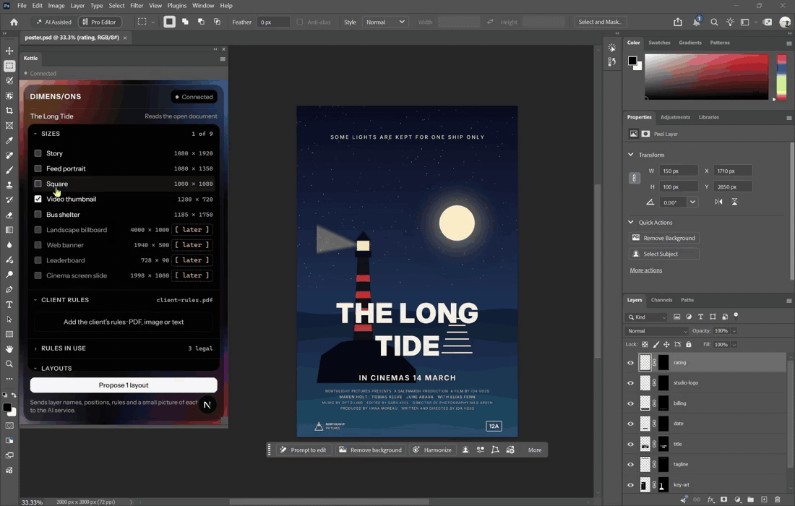
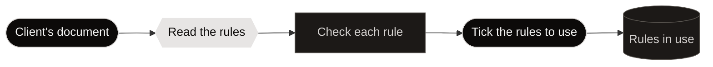
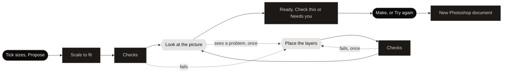

# Dimens/ons

A Photoshop panel that turns a film client's finished poster into the other sizes a campaign needs. Every legal line is checked in code, and every layer stays editable.



<sub>Sped up. The wait for the layout is about 40 seconds in real time.</sub>

Agency designers rebuild a client's one sheet by hand for 20 to 40 placements, at 15 to 40 minutes each. The time goes on repositioning the same eight elements. The expensive mistakes are the legal lines. This tool does the repositioning, checks the legal lines, and hands over by name anything it cannot do.

Built as a practice run for a two-hour brief: [`sample/02-poster-resize/BRIEF.md`](sample/02-poster-resize/BRIEF.md).

## How it works

1. **Add the client's rules.** The designer uploads the client's own document. The tool proposes one rule for each kind of layer, with the client's exact words beside it, and uses only the rules the designer ticks.
2. **Tick the sizes and press Propose.** Each size comes back with a preview and a label: **Ready**, **Check this** or **Needs you**, with the reason.
3. **Decide, size by size.** "Make in Photoshop" builds that size as a new document with every layer still movable. "Try again" asks for a new layout. A size that fails a check cannot be made.

> [ Still goes here: `docs/rules.png`. The proposed rules, with the client's words, being ticked. ]
>
> [ Still goes here: `docs/check-this.png`. A size marked "Check this", with its reason. ]

## Who does what

If a rule can be written down, code does it. A model is used only for judgment, and never has the last word.

| Step | Done by |
|---|---|
| Read the client's rules from a PDF, image or text file | **AI** |
| Check each proposed rule, and write the plain-words version the designer reads | Code |
| Choose which rules to use | Designer |
| Shrink the poster to fit a similar shape | Code |
| Lay out a size whose shape is very different | **AI** |
| Check every layout: legal lines present, nothing cropped or stretched, billing size, covered areas, logo clear space, overlapping text | Code |
| Look at a picture of the layout for what numbers cannot show, such as an island floating in the sky | **AI**, advice only |
| Make the size in Photoshop | Designer says yes, code does it |

It is a fixed chain with caps, not an agent. The steps are the same for every size and known before it starts, so the model never chooses what happens next.

## How it flows

Rounded boxes are the designer. Square boxes are code. Six-sided boxes are a model call.

**Reading the rules**



**Making a size**



The top row is the path when code alone is enough. The dotted lines are the only loops, and each has a cap.

## Run it

Needs Node 20.9 or later. The panel needs Photoshop 28 and UXP Developer Tool.

```bash
cd web
npm install
cp .env.example .env.local   # then add ANTHROPIC_API_KEY
npm run dev
```

Open http://localhost:3000 to use it in a browser on the sample poster. Without an API key it runs on sample output, and the panel says so.

Inside Photoshop:

1. Keep `npm run dev` running.
2. In UXP Developer Tool, add `plugin/manifest.json` and load it.
3. Open `sample/02-poster-resize/poster.psd`.
4. To try the rules reader, add `sample/02-poster-resize/client-rules.pdf` in the panel.

The poster is unreleased artwork, so the panel always says what leaves the computer: layer names, positions, the rules, and a small picture of each proposed layout go to the Anthropic API. The Photoshop file does not.

<details>
<summary>Where things are</summary>

| Path | What it is |
|---|---|
| `web/app/page.tsx` | The panel |
| `web/app/api/layout` | The chain: scale to fit, place, check |
| `web/app/api/review` | The look at a picture of a layout |
| `web/app/api/rules` | The rules reader |
| `web/lib/checks.ts` | Every check. No AI in this file. |
| `web/lib/layout.ts` | Geometry, and the rules in the form code checks |
| `web/lib/prompts.ts`, `web/lib/schemas.ts` | The prompts, and the shape every model answer must have |
| `web/lib/claude.ts` | The only file that calls the Anthropic API |
| `web/plan.ts` | Every decision, drawn at `/plan` |
| `plugin/` | The Photoshop side: hosts the panel and makes the documents |

</details>

<details>
<summary>What it does not do yet</summary>

- **Five of the nine sizes.** Story, Feed portrait, Square, Video thumbnail and Bus shelter. The four wide ones need a one-line title, which the poster does not have.
- **Previews are drawn from the sample layer images,** not from the pixels of the open document.
- **Quoted rules are only verified for text files.** For a PDF or an image the designer's read is the check, and the panel says so.
- **One set of rules at a time,** not one per document.
- **Nothing looks again after the designer edits a made document.**
- **Some rules are read but not enforced:** "may stack on two lines", "may be extended".
- **The areas each platform covers are written into code** from `sizes.json`.

</details>

## With more time

1. The four wide sizes, with a one-line title.
2. Check a document again after the designer has edited it, so legal lines are checked at hand-off and not only at proposal.
3. Rules saved per document, and edited in the panel.
4. A cost view for each run: which sizes code did for free, and what the model calls cost.
5. Layout suggestions by genre or style.
6. An on-device model for client-confidential files.

## How I worked with AI

The decisions, and the places I overruled or corrected the model, are logged in `web/plan.ts` and drawn at `/plan`. Working notes are in `NOTES.md`.
